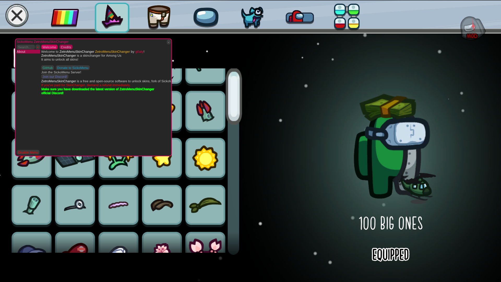

Just put a version.dll file to game directory and enjoy free skins!

This is a fork of SickoMenu, go check it out! https://github.com/g0aty/SickoMenu

Important: If you're version is Steam, Epic Games, Microsoft store select Version.zip
If you're on Itch.io version, select Version_Itch_x86.zip

